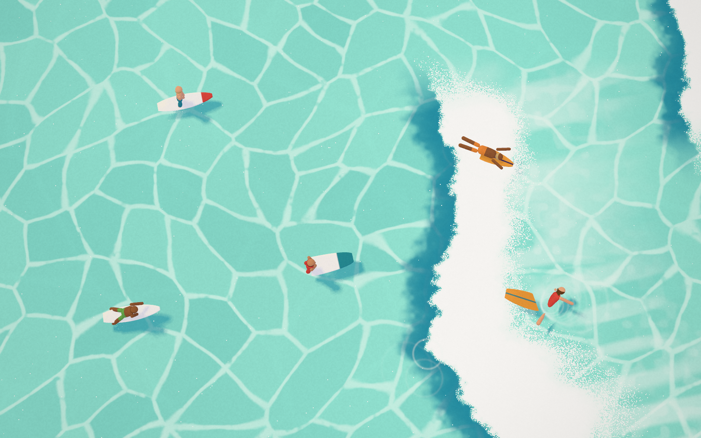
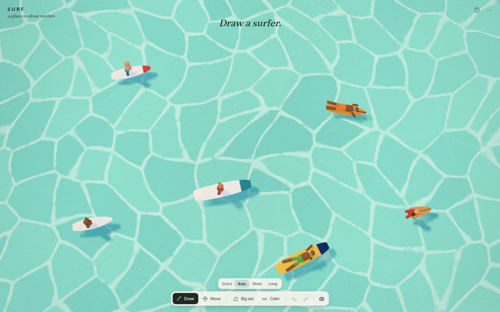

# SURF — case study

*Draw a quick stroke on a painted sea and a surfer paddles out of it.*

## Why surfers

POND came from MEADOW: what does "the line becomes a creature" look like in water? SURF started from an aerial photograph of surfers on a turquoise sea. The water is broken by a net of caustic light. Surfers sit in the line-up, and a band of white water sweeps through them.

The brief:
- add a surfer who paddles toward a wave, treads in place or rides one;
- let waves sweep them off, and now and then let a big one sweep everyone;
- use the photograph's colours, keep the water moving and show no land;
- give it the same feel as POND.

## What was kept, and what was new

SURF began as a copy of POND. Kept from it:
- the engine loop;
- the `paintLight` lavender shade and the `castLight` contact-hardening shadows;
- the `underwater()` tint;
- the watercolour bloom reveal and ripple pool;
- flat poses with cross-faded controllers, and the eased steering model (`steer.ts`);
- the pointer state machine;
- versioned immutable documents with undo;
- the recorder that composites the pen line;
- the test and QA tooling.

New:
- the sea and its waves;
- the camera;
- the surfer model, rig, behaviours and state machine;
- stroke reading;
- the board picker, big sets and calm.

Removed: everything on land (the tile on paper, banks, reeds, the dry-brush edge) and shape recognition, which a single kind of thing doesn't need.

## The sea

The reference has no horizon and no shore, so the camera looks almost straight down (pitch −77°, FOV 34°). Its distance is solved by bisection: the farthest camera at which a fixed play area still covers the whole screen. The ground under the screen corners then becomes the bounds surfers keep to. On a tall phone screen a taller, narrower area is used instead, so surfers stay the size they are on a laptop rather than ballooning.

One shader paints the sea:

- **Light cells.** Two Voronoi networks at different scales, domain-warped and drifting slowly against each other, give thin light lines. The lines break up where the networks disagree, as caustics do. The water between them is the reference's flat turquoise with a faint swell.
- **The wave.** It is drawn in three parts:
  - **Foam:** a dense white band with a lumpy, ragged leading edge, and stippled specks and thinning streaks trailing behind.
  - **Face:** ahead of the foam, a deep-teal shadow. It is measured from the ragged edge rather than the smooth crest, so it hugs the lumps instead of drifting apart from them.
  - **Drop shadow:** the boards' cast shadows are looked up at an offset, so they fall down-right as in the photograph and aren't hidden under the boards.
- **On top.** Bloom stains for new surfers, ripple rings from paddling, splashes and climbs, and a little grain.

## Waves as functions

A wave is a small record:
- origin along the direction of travel;
- speed and start time;
- life;
- `u0`, where along the crest it peaks;
- `halfLen`, how long a section breaks;
- a seed;
- whether it is a big set.

Waves travel from the right toward the left, at a slight angle. Each has three functions:
- `crestAt` gives the crest position, with a gentle wobble and a forward bulge at the peak.
- `wavePower` fades a wave in as it forms and out over its last seconds, and is stronger for a big set.
- `waveEnvelope` limits an ordinary wave to its breaking section, while a big set breaks all the way across.

The same functions exist in TypeScript and GLSL. So `sampleWave(x, z, t)` returns exactly what the shader paints there: signed distance to the crest, power, foam width and face width. The surfers use this one sense for everything: whether white water is on them, how far away the next crest is, and where along it the peak is.

The `WaveField` spawns an ordinary wave every 8–15 s and a big set every 60–90 s (or on demand, after a 2.5 s warning that also darkens the sea a little). It spawns nothing while calm. At most six waves are alive at once, packed into two `vec4` uniform arrays.

## The surfers

The board has a lens-shaped planform, built as `w = W·sin(a)^k`. Shortboards get a fuller exponent and longboards a slimmer one. It is extruded with a bevel and painted with a stringer, a nose stripe or both, in one of a handful of colours.

The rider is a few capsules on a small rig: a pelvis, a spine, a head with a hair cap (sometimes long hair) and two arms and legs. The surfer's seed sets their skin, hair, wetsuit or trunks, and board.

From above, the board carries most of the read. Two early problems:
- The first planform was arrow-shaped and read as a dart, so it became a lens.
- The first surfers were too small to see against the foam, so they were scaled up and the riders made a little larger relative to their boards.

Board and rider are separate scene roots. For most of their lives they move together. In a wipeout they part: the board flips and slides away while the rider tumbles. The rider then swims to the board and climbs back on, and the two are reattached exactly where they meet.

## Life

Each state has a pure, time-based pose, cross-faded from whatever was last shown:

| State | Pose | What happens |
|---|---|---|
| **wait** | sitting up, legs in the water, a slow tread | turns to face the incoming waves |
| **paddle** | prone, alternating strokes | heads out toward the waves |
| **dive** | 1.5 s: board nose pushed under, rider pressed flat, resurface | a ring when they come up |
| **catch** | prone, hard strokes | lines up across toward the wave's peak, turns to face the beach as the face arrives |
| **ride** | pop-up, then a low stance with S-carves | tracks just ahead of the crest and drifts along it |
| **wipeout** | 2.2 s: whole tumbling turns; the board flips and flies off | a burst of rings |
| **swim** | crawl stroke | swims to the board |
| **climb** | 0.9 s: hands on the rails, pull up, sit | back to wait |

The decisions:
- **Diving.** A waiting surfer who sees white water within two metres decides once per wave whether to duck-dive (60%). A paddling surfer always dives unless it's a big set, which cannot be dived.
- **Escaped waves.** A wave the surfer has dived under, ridden or been wiped out by is marked escaped. Without this, a wave that had just passed could sweep the same surfer a second time.
- **Riding.** A ride ends when:
  - the wave's power drops;
  - the surfer reaches the shoulder end of the breaking section;
  - they near the edge of the sea;
  - or after ten seconds.

  About one ride in six ends in a comic nose-dive.
- **Steering.** All movement goes through POND's eased steering. That steering came out of POND's jitter fixes: one turn rate, continuous avoidance and a preferred side in corners. Surfers also slow down to turn when their target is off to the side, so they don't circle.
- **Spacing.** Surfers who aren't riding give each other room with a soft, continuous push apart.

## Drawing

A surfer is one kind of thing, so a stroke only has to say where, which way and how big:
- The principal axis of the points gives the board's line.
- The direction the pen travelled along it gives the facing.
- The length of the stroke on the water gives the size, clamped.

A plain straight flick is the most natural gesture here. MEADOW's stroke analysis rejected straight lines as "too small", so SURF uses its own minimum length instead.

Auto picks a longboard for long strokes. Strokes in the white water or right at the edge are refused with a message.

The new surfer blooms in with POND's watercolour stain, in a colour taken from their board and suit. They can be picked while still forming.

## Testing

**Unit tests (33).** They cover:
- the wave functions and their limits;
- document parsing, clamping and the stroke reader;
- every pose being finite;
- a surfer riding near the foam;
- a duck-dive under a spawned wave;
- a big set sweeping everyone, all of whom swim back and reattach;
- facing after a wait;
- a fuzz of random actions;
- a smoothness check on heading and position across states.

**Playwright tests (14).** These run in real Chromium with WebGL via Metal, on the dev server and the production build. They cover:
- drawing and its refusals;
- the board picker;
- selection and actions;
- dragging;
- undo/redo;
- persistence and import;
- big set and calm;
- capture;
- the mobile layout;
- that the canvas actually shows the turquoise and the white water.

## What I'd do next

- Spray: a few painted droplets thrown off the lip and off a carving rail. Right now spray is suggested only by rings and specks.
- Sound: soft surf and a distant crash for a big set (there is no audio yet).
- Test in Safari and Firefox; only Chromium has been tested.
