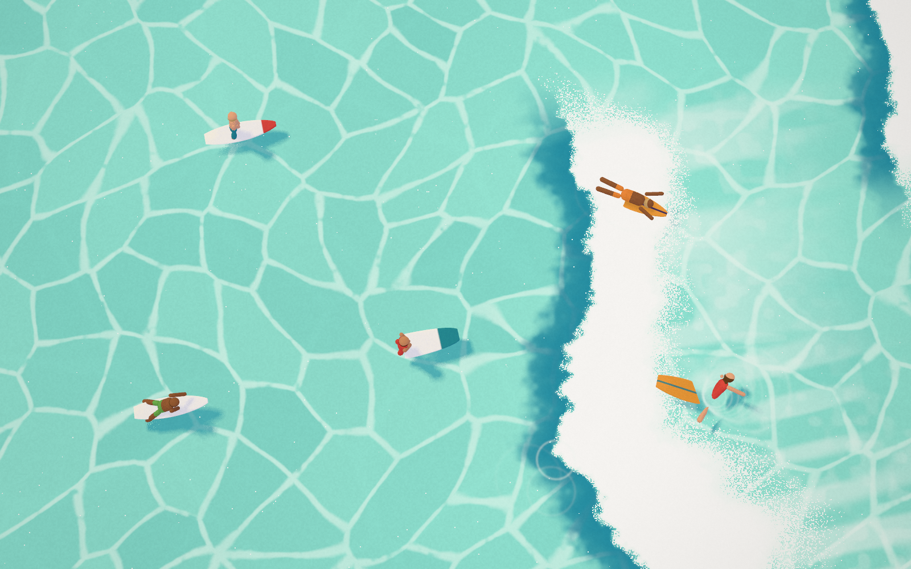
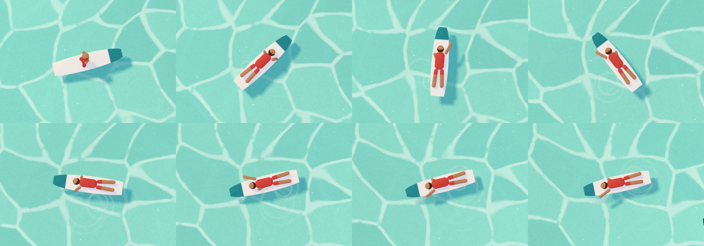
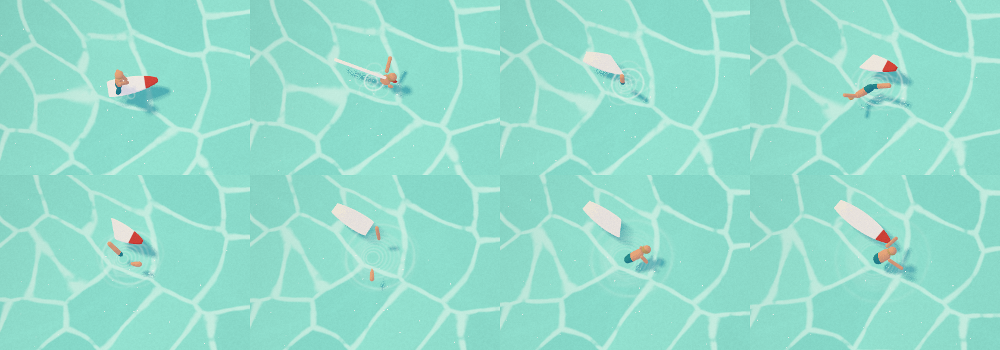
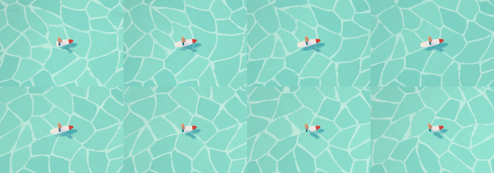

# SURF

**Draw a quick stroke on a painted sea and a surfer paddles out of it.**

SURF is a top-down view of a turquoise sea in the browser, with no land, only water. Draw a short stroke on the water and a surfer blooms into it like a drop of watercolour, lying on their board and facing the way you drew. Then they get on with it:

- They tread water and paddle out.
- They duck-dive under the white water or line up and catch a wave.
- They stand and carve along the face.
- Sometimes they wipe out spectacularly, then swim after their board and climb back on.

Every minute or so a big set rolls through and sweeps everyone off.

It is the sibling of [POND](https://github.com/Mariaareadne1/pond-interactive) (draw on a pond, get a koi) and [MEADOW](https://github.com/Mariaareadne1/meadow-interactive) (draw a loop, get a sheep). It shares their painted light, interaction grammar and tooling, with a new world that is all water and always moving.



| Catching a wave | Wiping out | The big set |
|---|---|---|
|  |  |  |

The demo runs 23 s. It was recorded by the app's own recorder, with the pen line included: [`docs/media/surf-demo.mp4`](docs/media/surf-demo.mp4). Its contact sheet is [`docs/media/demo-sheet.png`](docs/media/demo-sheet.png).

## Run it

```bash
npm install
npm run dev          # http://localhost:5404
```

Needs a browser with WebGL 2. Useful URLs:

| URL | What |
|---|---|
| `/` | Your saved sea, or three surfers on first visit |
| `/?showcase` | Six surfers on short and long boards |
| `/?empty` | An empty sea |
| `/?quality=low` | 2× MSAA, smaller shadow map, lower pixel-ratio cap |

## Drawing

Draw any quick stroke (a line, a flick or a loop) on the water. The surfer faces the direction you were drawing toward, and the stroke's length on the water sets their size.

The **Board** picker above the toolbar has three settings:
- **Auto** gives a longboard for long strokes and a shortboard otherwise.
- **Short** and **Long** force that board.

You get a gentle message and the line shivers away if:
- the stroke is too short;
- you drew too close to the edge;
- you drew in the white water;
- the line-up is full (24).

## What surfers do

Left alone, a surfer:
- sits up on their board facing the incoming waves and treads water;
- now and then paddles out or drifts to a new spot;
- duck-dives under white water that would reach them (a shortboarder usually does);
- gets swept off when they don't dive.

When swept off, the rider tumbles in whole turns while the board flips away on its own. The surfer then swims to the board and climbs back on.

Click a surfer for these actions:

| Action | What it does |
|---|---|
| **Paddle out** | Lies down and paddles toward the waves, diving under any white water on the way |
| **Wait** | Sits up and treads water, facing the waves |
| **Catch the next wave** | Lines up with the wave's peak and paddles hard as it arrives. On the face they pop up and ride along it in S-carves. They kick out when the wave fades or reaches its shoulder, or now and then nose-dive into a wipeout. |
| **Wipe out** | Off they go, right now |

Every surfer can also be turned ↺ ↻, duplicated, removed, or dragged to move (they shrink a little as they go farther away).

Sea-wide controls:
- **Big set** (`B`) calls a big wave now, after a short warning. It spans the whole sea and sweeps everyone off, even riders.
- **Calm** (`C`) stops new waves until you turn it off.

## Keys

| | |
|---|---|
| Draw · Move | `D` · `V` |
| Board: Auto · Short · Long | `A` · `S` · `L` |
| Surfer actions | `1`–`4` (Paddle out, Wait, Catch, Wipe out) |
| Turn | `Q` / `E`, or scroll |
| Duplicate / remove | `Shift D` / `Delete` |
| Big set · Calm | `B` · `C` |
| Undo / redo | `⌘Z` / `⇧⌘Z` |
| Next surfer | `Tab` |
| Deselect / cancel | `Esc` |
| Hide interface | `H` |

The menu has:
- Showcase arrangement
- Record 12-second clip (MP4/H.264 where supported, else WebM, with the drawn line)
- Hide interface
- Export/Import scene JSON
- Clear the sea

Scenes save automatically in the browser (`{ version: 1, surfers: [...] }`). Imported files are validated, clamped to the sea and capped.

## How it works (short version)

- **One painted sea.** A single shader on a large plane:
  - two drifting, warped Voronoi networks of thin, broken light lines (the "caustic cells" of the reference);
  - gentle swell shading;
  - the waves.
  The camera looks almost straight down. Its distance is solved so the play area covers any screen; tall screens get a taller, narrower stretch of sea.
- **Waves as functions.** Each wave is a few numbers:
  - origin, speed and start time;
  - where along the crest it peaks;
  - how long a section breaks;
  - whether it is a big set.

  `crestAt`, `wavePower` and `waveEnvelope` have identical TypeScript and GLSL twins, so the foam you see is exactly what surfers feel. Ahead of the foam, a deep-teal shadow marks the face; behind it, thinning streaks and stippled specks.
- **Surfers from code.** Each surfer is:
  - a lens-shaped extruded board, with a stringer or nose stripe;
  - a capsule body on a small rig.

  Everything is painted in one shader with POND's lavender-shade light, underwater tint for the parts below the surface, and a wet edge. Board and rider are separate roots, so a wipeout can part them.
- **Life.** Pure time-based poses (sit, prone paddle, duck-dive, pop-up and stand, tumble, swim, climb) are cross-faded from the pose actually shown. A controller per surfer owns the state machine and root motion against the wave field, using POND's smooth steering (one eased turn rate, continuous avoidance, no snapping).

The full write-up is in **[CASE_STUDY.md](CASE_STUDY.md)**; build notes are in [PROGRESS.md](PROGRESS.md); the palette and reference analysis are in [docs/ART_DIRECTION.md](docs/ART_DIRECTION.md).

## Development

```bash
npm run typecheck      # tsc
npm run lint           # eslint
npm test               # unit tests (vitest)
npm run test:e2e       # real-browser tests (Playwright, WebGL via Metal)
E2E_PROD=1 npm run test:e2e   # same, against the production build
npm run build          # dist/
```

QA scripts (need the dev server; write to `artifacts/`, gitignored):

| Script | Output |
|---|---|
| `node scripts/shoot.mjs name [query] [w] [h] [waitMs]` | Full-frame screenshot (`SURF_EVAL` runs code first) |
| `node scripts/strip.mjs name id action [frames] [every] [crop]` | Filmstrip of one surfer (`catch`, `wipeout`, `paddle`, `bigset`, `wave`) in the app camera |
| `node scripts/montage.mjs` | Contact sheet of artifacts |
| `node scripts/demo.mjs 1600 900` | Scripted demo recorded through the app's recorder |
| `node scripts/verify-recording.mjs` | Records 4 s and checks codec, size and frames with ffprobe |
| `node scripts/perf.mjs` | Back-to-back frame timings with a GPU sync |

Headless Chromium must use `--use-angle=metal` on macOS, because SwiftShader is far too slow.

## Deploying

SURF is not deployed yet. It is a static site with no server, keys or environment variables. `vercel.json` sets the Vite build, long-lived caching for hashed assets and basic security headers. When it should go public, deploy it to its own Vercel project:

```bash
npx vercel --prod --project surf-interactive
```

## Credits and licences

- Code: MIT, © 2026 Maria Showalter.
- Everything in the scene is generated by code in this repository; there are no third-party models, textures or images. The aerial photograph used as a colour and mood reference is not included.
- Fonts: Inter Tight and Fraunces (SIL OFL 1.1) via Fontsource.
- Engine, light model, stroke handling, steering and tooling are adapted from POND and MEADOW (same author, MIT).
